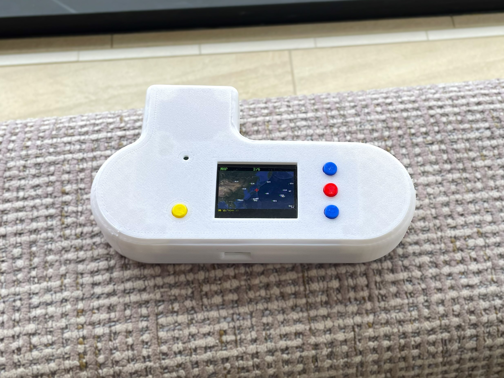
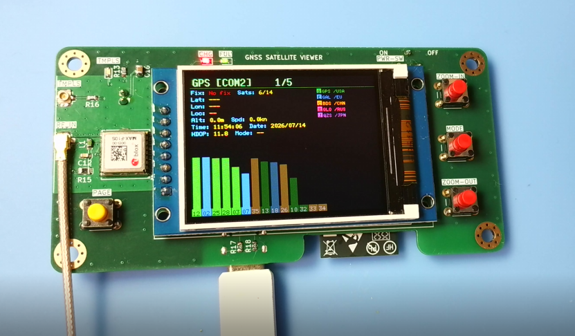
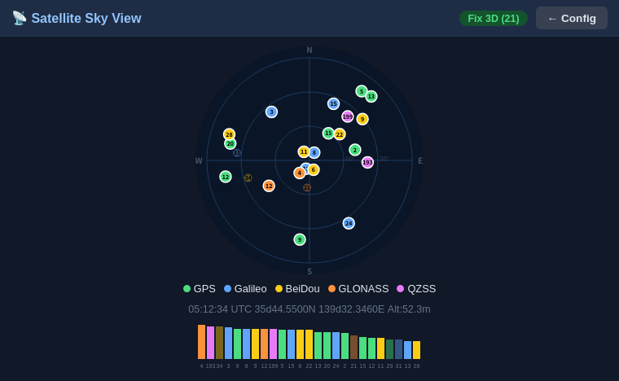
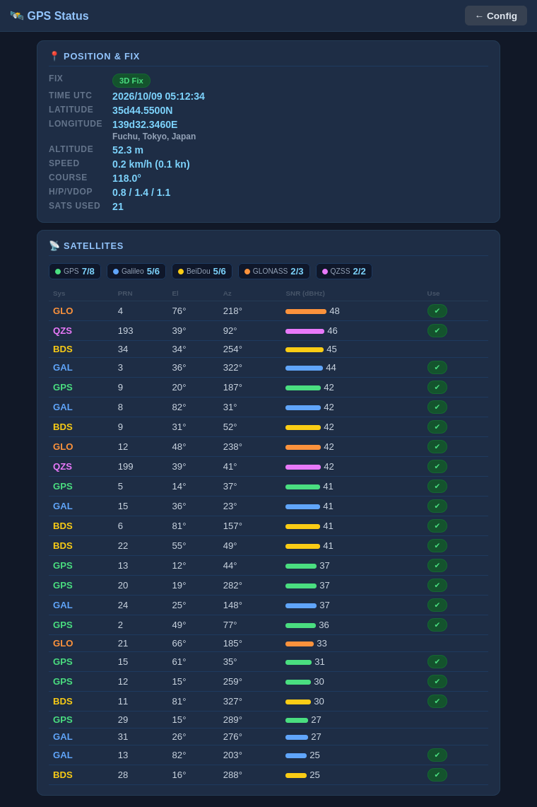
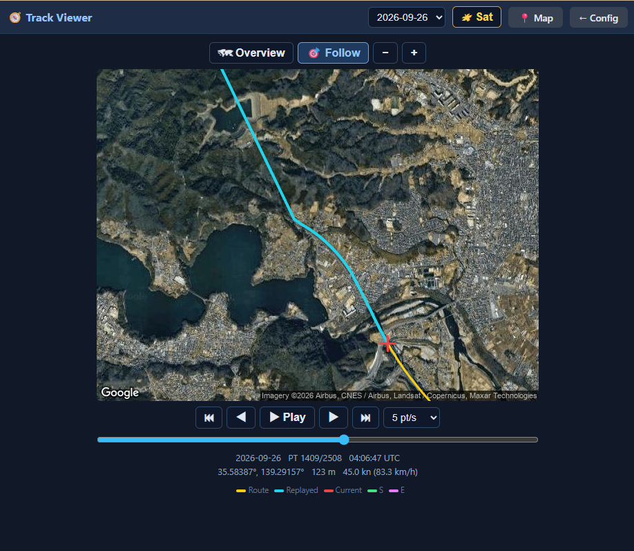

<div align="center">
  <h1><code>GNSS Satellite Viewer</code></h1>
  <p>
    
  </p>
</div>

ESP32-S3 firmware for a handheld GNSS receiver display built around a u-blox
**MAX-F10S** module.  It decodes the receiver's NMEA output and shows the fix,
satellite constellation, a live map and recorded tracks on a 320×240 colour TFT,
and serves the same data over Wi-Fi to a browser.  Written in
Rust (esp-idf-hal / esp-idf-svc) with a C component (wolfSSH) for an SSH
console to the receiver.

## Features

| Feature | Description |
|---------|-------------|
| GNSS status | Fix quality, position, altitude, speed, course, HDOP/VDOP, satellites used/in view, UTC time (GPS, Galileo, BeiDou, GLONASS, QZSS, NavIC as supported by the receiver) |
| Sky view | Polar plot of every tracked satellite by azimuth/elevation, coloured by constellation, with an SNR bar chart |
| Live map | Google Maps Static API tile (satellite or roadmap) centred on the current fix, with a position trail, crosshair and scale bar |
| Offline map cache | Every downloaded tile is cached on eMMC; the nearest cached tile is shown when Wi-Fi or the API key is unavailable |
| Track log | Fixes are logged to a daily CSV on eMMC and can be browsed and replayed on the map (see [Track playback](#track-playback)) |
| Reverse geocoding | Street address for the current position via OpenStreetMap Nominatim |
| Earthquakes / EEW | Optional (`quake_enable`): recent earthquakes and emergency earthquake warnings from P2P地震情報, shown on a TFT page, plotted on the map and listed in the Web UI (see [Earthquakes and EEW](#earthquakes-and-eew-p2p地震情報)) |
| Time sync | System time from the GNSS receiver, plus NTP (up to 4 servers) |
| Web UI | Browser-based configuration, map, sky view, GNSS status and serial terminal |
| SSH console | Transparent SSH access to the receiver's serial port (`ssh … console com1`) |
| WPS | Wi-Fi Protected Setup (PBC mode) via `cfg.toml` or the Web UI |
| UDP Syslog | RFC 5424 remote logging over UDP |
| NVS settings | Persistent configuration stored in NVS; editable via the Web UI at runtime |

---

## Hardware



The reference hardware is a custom board; the KiCad design files and
production data (BOM, placement, netlist) are in [`hw/`](hw/).

| Part | Notes |
|------|-------|
| MCU | ESP32-S3 with 16 MB flash and octal PSRAM |
| GNSS receiver | u-blox MAX-F10S on UART1 (COM1), 9600 baud default |
| Display | ST7789V 320×240 SPI TFT |
| Storage | **64 GB eMMC** on the 8-bit SDMMC bus, mounted at `/emmc` (map tile cache and track log) |
| Battery | **LiPo, 1100 mAh**, on a JST-PH 2-pin connector; MCP73831 charge controller on board.  Voltage is read on GPIO13 (see `adc_conversion_factor`) |
| 1PPS output | **Internal** 1PPS (time-pulse) output port from the MAX-F10S TIMEPULSE1 pin.  1 Hz by default; the frequency (disabled, 1 Hz … 10 MHz) is set under *GPS TIMEPULSE* in the Web UI configuration page, saved in NVS and re-applied to the receiver at every boot |
| RTC | 32.768 kHz crystal on GPIO15/16 |
| Buttons | BOOT (GPIO0) plus three user buttons (GPIO4/5/6) |

### Pin assignment

| Function | GPIO |
|----------|------|
| GNSS UART1 TX / RX | 42 / 41 (`com1_tx_pin` / `com1_rx_pin`) |
| TFT SCLK / MOSI / CS / DC / RST | 48 / 45 / 40 / 39 / 38 |
| eMMC CLK / CMD | 46 / 3 |
| eMMC D0–D7 | 47, 21, 10, 9, 17, 18, 8, 7 |
| Battery voltage (ADC) | 13 |
| Power-source detect | 1 (high = DC jack, low = USB) |
| Buttons | 0 (BOOT/Page), 4 (+), 5 (−), 6 (MAP mode) |

---

## Display Pages

The BOOT button cycles through the pages in this order:

| # | Page | Content |
|---|------|---------|
| 1 | GPS | Fix info, position, location name and satellite SNR bar chart |
| 2 | SKY VIEW | Polar satellite plot and per-satellite panel |
| 3 | MAP | Live map with trail, or the track being replayed |
| 4 | SAVED TRACKS | List of recorded tracks |
| 5 | SERIAL [COM1] | Raw terminal view of the receiver's serial stream |
| 6 | SYSTEM INFO | IP address, SSID, RSSI, battery voltage, chip temperature, free heap, serial settings |
| 7 | EARTHQUAKE | Recent earthquakes (only with `quake_enable = "true"`) |

### Buttons

| GPIO | Label | Short press | Hold |
|------|-------|-------------|------|
| 0 (BOOT) | Page | Next page — or end track playback | ≥ 10 s: factory reset |
| 4 | + | Context dependent (below) | Auto-repeat |
| 5 | − | Context dependent (below) | Auto-repeat |
| 6 | MAP mode | Toggle satellite ↔ roadmap — start playback on the track list — show the highlighted epicenter on the quake page | — |

GPIO4/5 act as follows:

| Where | GPIO4 (+) / GPIO5 (−) |
|-------|----------------------|
| MAP page, live | Zoom in / out |
| MAP page, track playback | Next / previous point (×10 once the button auto-repeats) |
| SAVED TRACKS page | Move the highlight down / up |
| EARTHQUAKE page | Move the highlight down / up |

Buttons are debounced at 50 ms; auto-repeat starts after 400 ms and repeats
every 300 ms.

**Factory reset** — hold BOOT for 10 s.  From 6 s the display shows a
"FACTORY RESET" countdown; at 10 s it erases NVS, restores the `cfg.toml`
defaults and reboots.

---

## Track Playback

While a fix is valid, the position is logged at most once every 5 s to
`/emmc/tracks/YYYY-MM-DD.csv` (UTC date, one file per day):

```
time_utc,lat,lon,alt_m,speed_kn,course_deg,fix_quality,num_sats,hdop
```

To replay a track:

1. Press **BOOT** until the **SAVED TRACKS** page is shown (newest date first).
2. Use **+ / −** to highlight a day and press **MAP mode** to start.
3. For the first 5 seconds the map is zoomed out to show the **whole route** (yellow
   line) and the **end point** (`E`).  It then returns to your normal tracking
   scale, starting at the first point.
4. **+ / −** step through the recorded points — hold the button to move ten at a
   time.  The info bar shows the date, point number, time, altitude and speed.
5. Press **BOOT** to end playback and return to the live map.

Tracks can be deleted from the Web UI (Storage section).

### Browsing tracks in the Web UI

Open **Tracks** from the configuration page (or `http://<device_ip>/tracks`).
Pick a day from the drop-down; the whole route (yellow) is shown first with its
start (`S`) and end (`E`).  Use ◀ ▶ / ⏮ ⏭ (±1 / ±10 points), the slider, or the
arrow keys (Shift = ±10) to move through the points, or **Play** to replay at
1–20 points per second.  **Overview** keeps the whole route in view; **Follow**
(selected automatically by Play and by the zoom buttons) centres on the current
point at the zoom you choose.

The viewer runs in the browser and is independent of the device: it does not
change what the LCD is showing, and the LCD's track playback does not affect it.
Like the Map page, it loads the map image straight from Google using the
`maps_api_key` (without a key the route is still drawn, on a plain background).

---

## Earthquakes and EEW (P2P地震情報)

With `quake_enable = "true"` in `cfg.toml` (default `"false"`) the unit shows
recent earthquakes and emergency earthquake warnings (緊急地震速報, EEW) from
[P2P地震情報](https://www.p2pquake.net/) (JSON API v2).  The data is
originally issued by the Japan Meteorological Agency (気象庁).  It needs Wi-Fi
and a synced clock (GNSS or NTP), because the connection is TLS.

| Where | What you get |
|-------|--------------|
| **EARTHQUAKE** page (TFT, page 7) | The 8 most recent events: time (JST), magnitude, maximum intensity (`I5-` = 5弱, `I5+` = 5強, …), depth and epicenter coordinates; tsunami warnings are flagged.  **+ / −** move the highlight, **MAP mode** (GPIO6) shows the highlighted epicenter on the MAP page |
| **MAP** page | Epicenters of recent earthquakes inside the visible map are drawn as circles — sized by magnitude, coloured by maximum intensity — with a label such as `M5.2 I5-` |
| **Web UI** (configuration page) | A *Recent Earthquakes* card with the epicenter name (Japanese), magnitude, intensity, depth and tsunami status.  The epicenter name opens the Web UI map (`/map?lat=…&lon=…&zoom=…`) centred on it |
| **EEW alert** | On a warning the TFT switches to the MAP page by itself and frames the epicenter **and this unit's own position** at the largest zoom that shows both: the epicenter is a large red `X`, joined to your position by a line, the header turns red (`!! EEW M6.3 I5- !!`) and the info bar shows magnitude, maximum forecast intensity, depth and the distance in km.  The Web UI shows a red banner with the forecast areas and a link to the same map view.  The alert stays up for 2 minutes, or until it is cancelled or **BOOT** is pressed |

The TFT font is ASCII only, so Japanese epicenter and area names appear in the
Web UI only; the TFT shows coordinates.  Without a GNSS fix the alert still
shows the epicenter, but cannot mark your position or give a distance.

How it works (`src/quake.rs`):

- A WebSocket (`wss://api.p2pquake.net/v2/ws`) receives the events as they are
  registered.  Warnings (code 556) raise the alert, earthquake reports (551) are
  merged into the list.  Test messages and warnings older than 3 minutes (by
  their issue time) are ignored, so a boot in the middle of an old event does
  not alert.
- REST (`/v2/history`) loads the initial list at boot, re-syncs it every
  30 minutes, and takes over — polling every 10 s (EEW) / 60 s (list) — while
  the WebSocket is down.
- **Memory:** the TLS WebSocket holds roughly 30 KB of internal RAM, which
  competes with the map tile download.  The WebSocket is therefore dropped for
  the duration of every map fetch and re-created once the map has been idle for
  about 12 s; any warning issued in the gap is recovered by a REST check right
  after it reconnects.  REST polling is skipped while internal RAM is low or a
  map fetch is running.  Watch *Free Heap (Internal)* in the Web UI and
  `[HEAP]` / `[WS]` / `[QUAKE]` in the log.
- The WebSocket needs the `esp_websocket_client` ESP-IDF component, pulled from
  the component registry at build time (declared in `Cargo.toml`), so the first
  build needs network access.

**Testing without a real earthquake.**  Build with the sandbox feature:

```bash
cargo build --release --features quake-sandbox
```

This points the feed at the P2P sandbox, which replays old data (including a
2023 Hokkaido EEW) and skips the "older than 3 minutes" check, so the whole
alert path fires right after boot.  Never ship a sandbox build.

> **Not a safety device.**  Delivery is not guaranteed and can be delayed; the
> warning only covers what the Meteorological Agency issues as a warning.  Do
> not rely on this unit for life-safety decisions.  Use the official channels.
> Use of the data is subject to the P2P地震情報
> [terms for secondary use](https://www.p2pquake.net/secondary_use/): credit the
> Japan Meteorological Agency and P2P地震情報 (the Web UI card already does).

---

## Architecture

```
u-blox MAX-F10S ──[UART1 / COM1]──► usb_host.rs (serial bridge)
                                      ├── gps_parser.rs ──► GPS state (fix, sats)
                                      │     ├── track_log.rs ─► /emmc/tracks/*.csv
                                      │     └── geocoder.rs ──► address lookup
                                      ├── serial_display.rs (TFT pages)
                                      ├── WebSocket terminal  (/terminal)
                                      └── ssh_bridge.c (wolfSSH, port 22)

map_display.rs ── persistent fetch worker ──► Google Static Maps (HTTPS)
      │                                         └── map_cache.rs ─► /emmc/mapcache
      └── MAP page / Web UI (/map)

track_view.rs ── track list + playback state for the MAP / SAVED TRACKS pages

quake.rs ── WebSocket (EEW + events) + REST ──► p2pquake.net   (quake_enable)
      └── EARTHQUAKE page / MAP overlay / EEW alert / Web UI card
```

---

## Directory Layout

```
satellite-viewer/
├── src/
│   ├── main.rs           # Entry point, peripheral initialisation
│   ├── usb_host.rs       # COM1 UART bridge to the GNSS receiver + SSH bridge control
│   ├── gps_parser.rs     # NMEA / UBX parser, GPS state, time sync
│   ├── serial_display.rs # ST7789V pages: GPS, sky view, map, track list, terminal, info, earthquake
│   ├── map_display.rs    # Map tile fetch, JPEG decode, zoom, position trail
│   ├── map_cache.rs      # eMMC tile cache index and eviction
│   ├── track_log.rs      # Daily CSV track logging
│   ├── track_view.rs     # Track list and playback state
│   ├── geocoder.rs       # Reverse geocoding (Nominatim)
│   ├── quake.rs          # Earthquake list + EEW (P2P地震情報 WebSocket / REST)
│   ├── emmc.rs           # eMMC (SDMMC 8-bit) mount
│   ├── httpserver.rs     # HTTP/WebSocket server, NVS config management
│   ├── wifi.rs           # Wi-Fi STA connection (DHCP / static IP) and WPS
│   ├── syslogger.rs      # UDP Syslog logger (RFC 5424)
│   ├── btn_ctrl.rs       # Button handling
│   ├── boot_log.rs       # NVS boot counter and rolling reset-reason log (last 10 entries)
│   └── gpio_ctrl.rs      # Shared GPIO state
├── components/
│   ├── ssh_bridge/       # SSH server C component (wolfSSH wrapper)
│   ├── wolfssh/          # wolfSSH (github.com/wolfSSL/wolfssh, commit 157cb01f)
│   └── wolfssl/          # wolfSSL/wolfCrypt (github.com/wolfSSL/wolfssl, commit b7e7e755)
├── hw/                   # KiCad schematic/PCB and production files
├── static/               # Embedded static files (xterm.js / css / fit addon)
├── cfg.toml              # Build-time default configuration (gitignored — contains credentials)
├── cfg.toml.tmp          # Template for cfg.toml (safe to commit)
├── sdkconfig.defaults    # ESP-IDF build settings
├── partitions.csv        # Flash partition table
├── setup_components.sh   # Initial setup script for components/
├── setup_env.sh          # One-shot environment setup (Rust, espup, udev)
└── build-flash-images.sh # Build a merged flash image from the cfg.toml.tmp defaults
```

---

## Configuration

### cfg.toml (build-time defaults)

`cfg.toml.tmp` is the only template.  Before building, copy it to `cfg.toml`
(which is not committed, since it holds your Wi-Fi credentials and API key):

```bash
cp cfg.toml.tmp cfg.toml
```

Then edit `cfg.toml` for your environment.  The table name must match the crate
name, `[satellite-viewer]`, or the values are ignored.  Hardware variants are
selected with the settings below rather than separate templates:

| Setting | Default | Change it when |
|---------|---------|----------------|
| `com1_tx_pin` / `com1_rx_pin` | `42` / `41` | The GNSS receiver is wired to other pins (XIAO ESP32S3: `43` / `44`) |
| `display_enable` | `"true"` | There is no ST7789V TFT |
| `emmc_enable` | `"true"` | This unit has no eMMC fitted |
| `quake_enable` | `"false"` | You want the earthquake list and EEW alerts (P2P地震情報; uses a WebSocket and ~30 KB of internal RAM) |

```toml
[satellite-viewer]
wifi_ssid      = "your-ssid"
wifi_psk       = "your-password"
wps_enable     = "false"          # "true": use WPS PBC on boot when wifi_ssid is empty
ip_mode        = "dhcp"           # "dhcp" or "static"
ip_address     = "192.168.2.200"
subnet_mask    = "255.255.255.0"
gateway        = "192.168.2.1"
dns            = "1.1.1.1"

syslog_server    = "192.168.2.140:514"
syslog_enable    = "false"
syslog_host_name = "esp32s3"
syslog_app_name  = "satellite-viewer"

ssh_user     = "admin"
ssh_password = "sshpass"

com1_tx_pin = "42"        # Wired to the GNSS receiver (XIAO-ESP32S3: 43)
com1_rx_pin = "41"        # (XIAO-ESP32S3: 44)
com1_baud   = "9600"      # MAX-F10S factory default

display_enable      = "true"
display_port        = "com1"
emmc_enable         = "true"    # eMMC map cache and track log
quake_enable        = "false"   # "true": recent earthquakes + EEW alerts from p2pquake.net (TFT page, MAP overlay, Web UI)

# NTP servers (up to 4, in priority order)
ntp_server1 = "time.aws.com"
ntp_server2 = "time.google.com"
ntp_server3 = "time.cloudflare.com"
ntp_server4 = "ntp.nict.jp"

# Google Maps Static API key — empty disables live map fetching
# (cached tiles are still shown)
maps_api_key = ""   # default only; can also be set in the Web UI — see "Google Maps API key" below

# Factor to convert the battery ADC reading to volts (depends on the divider)
adc_conversion_factor = "74.47"
```

Values in `cfg.toml` are compiled into the firmware as defaults.
After boot they can be overridden via the Web UI or direct NVS writes; NVS values take priority.

### Google Maps API key

The map pages (LCD and Web UI) download images from the **Maps Static API**, so
they need a Google Maps Platform API key.  Without `maps_api_key` the MAP page
can still display tiles already stored in the eMMC cache, but will not download
new ones.

**Where to get one**

1. Sign in to the [Google Cloud console](https://console.cloud.google.com/) and
   create (or select) a project.
2. Link a **billing account** to the project.  Maps Platform APIs require one,
   even though usage within the free monthly allowance is not charged — see the
   [Google Maps Platform pricing](https://mapsplatform.google.com/pricing/) page
   for the current allowance.
3. Open **APIs & Services → Library**, search for **Maps Static API** and click
   **Enable**.
4. Open **APIs & Services → Credentials**, click **Create credentials → API key**
   and copy the key.  Step-by-step instructions are in Google's
   [Maps Static API documentation](https://developers.google.com/maps/documentation/maps-static/get-api-key).
5. Enter the key in the Web UI: **Config page → Map Settings → Google Maps API
   Key**, then **Save**.  It takes effect immediately (no reboot) and is stored
   in NVS.  To have a key built in as the default instead (for a fresh or
   factory-reset device), set it in `cfg.toml` and rebuild:

   ```toml
   maps_api_key = "your-api-key"
   ```

**Notes**

- The key is stored in NVS and can be changed from the Web UI at any time.
  `maps_api_key` in `cfg.toml` is only the default, used until a key is saved
  and restored by a factory reset (saving an empty field also falls back to it).
- The Web UI map pages load images directly from Google in your browser, so the
  device hands the key to any logged-in browser (`/api/mapkey`).  Keep the
  device login password strong, and do not share firmware images built with your
  own key (`build-flash-images.sh` builds from `cfg.toml.tmp`, whose key is empty).
- In the Cloud console, restrict the key under **API restrictions** to the
  **Maps Static API** only, and set a budget alert or quota so a leaked key cannot
  run up a bill.  An application restriction (HTTP referrer / IP) is awkward here
  because requests come both from the device and from browsers on your LAN.
- `cfg.toml` is not committed.  Never put a real key in `cfg.toml.tmp`, which is
  the template that gets committed.  Because the Web UI can set the key, you can
  leave `cfg.toml` empty and keep the key out of the build entirely.

---

## Wi-Fi Setup with WPS

**WPS (Wi-Fi Protected Setup)** allows you to connect to a Wi-Fi network without manually entering the SSID and password. This device supports **WPS Push Button Configuration (PBC)** mode.

### Method 1: Using cfg.toml and Factory Reset (Recommended for initial setup)

If you don't have Wi-Fi credentials yet or want to reconfigure via WPS without Web UI access:

1. **Edit `cfg.toml` before building** (or rebuild the firmware):
   ```toml
   wifi_ssid      = ""           # Set to empty string
   wps_enable     = "true"       # Enable WPS mode on boot
   ```

2. **Flash the firmware** to the device

3. On boot, the device will automatically enter WPS mode and wait for you to **press the WPS button on your Wi-Fi router** (timeout: 2 minutes)

4. Upon successful WPS connection, the credentials are saved to NVS and the device reboots

**Alternative: Trigger WPS via Factory Reset**

If the device is already running with Wi-Fi configured but you want to switch to WPS:

1. **Edit `cfg.toml`** to set `wps_enable = "true"` and `wifi_ssid = ""`
2. **Rebuild and flash** the firmware
3. **Perform a Factory Reset**: Press and hold the BOOT button (GPIO 0) for **≥10 seconds**
4. The device will erase NVS, restore `cfg.toml` defaults, and reboot into WPS mode
5. **Press the WPS button on your Wi-Fi router** within 2 minutes

> **Note**: Web UI is not accessible until Wi-Fi is connected, so this method is essential for initial setup or when you lose Wi-Fi access.

### Method 2: Using the Web UI (when already connected to Wi-Fi)

1. Navigate to the configuration page at `http://<device_ip>/`
2. Find the **WPS** section
3. Click the **"Start WPS"** button
4. **Press the WPS button on your Wi-Fi router** within 2 minutes
5. The device will automatically receive and save the Wi-Fi credentials and reboot

### WPS Fallback

If WPS fails or times out, the device will revert to the previously configured Wi-Fi credentials (from `cfg.toml` or NVS).

### Notes

- WPS PBC mode is the only supported WPS method (PIN mode is not supported)
- After successful WPS configuration, the new credentials are saved to NVS and persist across reboots
- You can still manually configure Wi-Fi credentials via `cfg.toml` or the Web UI if WPS is not available on your router

---

## Environment Setup

Run `setup_env.sh` **once** on a fresh Ubuntu / Debian machine (or WSL2) before
building.  The script performs all steps below automatically.

```bash
bash setup_env.sh
```

After the script finishes, open a new terminal (or reload your shell config) so
the environment variables take effect:

```bash
source "$HOME/.cargo/env"
source ~/export-esp.sh
```

### What the script does

| Step | Action |
|------|--------|
| 1 | Install system packages via `apt` |
| 2 | Install Rust toolchain via `rustup` (skipped if already present) |
| 3 | Install `ldproxy`, `espup`, `cargo-espflash` via Cargo |
| 4 | Install & update the ESP32-S3 Xtensa toolchain via `espup` |
| 5 | Source `~/export-esp.sh` (generated by `espup`) |
| 6 | Add udev rule for ESP32 USB device (`303a:1001`) and reload rules |

> If you prefer to run the steps manually, expand the section below.

<details>
<summary>Manual setup steps</summary>

```bash
# 1. System packages
sudo apt update && sudo apt -y install \
    git python3 python3-pip gcc build-essential curl \
    pkg-config libudev-dev libtinfo5 clang libclang-dev \
    llvm-dev udev libssl-dev python3.10-venv

# 2. Rust
curl --proto '=https' --tlsv1.2 -sSf https://sh.rustup.rs | sh
# Select option 1 (default install), then:
source "$HOME/.cargo/env"

# 3. Cargo tools
cargo install ldproxy
cargo install espup
cargo install cargo-espflash

# 4. ESP32-S3 toolchain
espup install
espup update

# 5. Activate ESP environment (add to ~/.bashrc / ~/.zshrc for persistence)
. ~/export-esp.sh

# 6. udev rules
sudo sh -c 'echo "SUBSYSTEMS==\"usb\", ATTRS{idVendor}==\"303a\", ATTRS{idProduct}==\"1001\", MODE=\"0666\"" > /etc/udev/rules.d/99-esp32.rules'
sudo udevadm control --reload-rules
sudo udevadm trigger
```

</details>

---

## Build and Flash

### Prerequisites

- Rust toolchain: `esp` channel (selected automatically via `rust-toolchain.toml`)
- [espup](https://github.com/esp-rs/espup) — ESP32-S3 Xtensa toolchain
- [espflash](https://github.com/esp-rs/espflash)
- ESP-IDF v5.4.2 (fetched automatically by the build)

### Initial component setup

Run once after cloning, or after a clean wipe of `components/`:

```bash
cd esp32-s3/satellite-viewer
bash setup_components.sh
```

This clones wolfssh and wolfssl at the verified commits, places the
ESP-IDF-specific `CMakeLists.txt` and `include/user_settings.h` on top, and
patches the FAT filesystem configuration to enable exFAT for the eMMC.

### Build

```bash
cargo build --release
```

The first build downloads the `esp_websocket_client` component (used by the
[earthquake feed](#earthquakes-and-eew-p2p地震情報)), so it needs network access.
Add `--features quake-sandbox` to test that feed against the P2P sandbox.

### Flash and monitor

```bash
espflash flash --release --monitor
```

### Creating a complete flash binary image

To create a single binary file that includes all partitions (bootloader, partition table, nvs, phy_init, and factory app) for distribution or web-based flashing:

```bash
cargo espflash save-image --release --merge --chip esp32s3 complete_flash.bin
```

To build a merged image from the `cfg.toml.tmp` defaults in one go (Wi-Fi and
API key unset, for distribution), run `build-flash-images.sh`; the result is
written to `flash_images/flash_satellite-viewer.bin`.  Your own `cfg.toml` is
restored afterwards.

**Important**: When flashing a merged image, always write it to **offset 0x0**, not 0x9000. Writing to 0x9000 will result in a boot failure with "invalid header: 0xffffffff" error.

#### Flash the complete binary

```bash
# Using esptool.py
esptool.py --chip esp32s3 --port /dev/ttyACM0 write_flash 0x0 complete_flash.bin

# Using espflash
espflash write-bin 0x0 complete_flash.bin
```

#### Web-based flashing (no command line required)

You can also flash the binary via a web browser using the ESP Web Flasher:

1. Open [https://thelastoutpostworkshop.github.io/ESPConnect/](https://thelastoutpostworkshop.github.io/ESPConnect/) in Chrome, Edge, or Opera (Web Serial API required)
2. Click **"Connect"** and select your ESP32-S3 device from the serial port list
3. Click **"Choose File"** and select `complete_flash.bin`
4. Set the flash address to **`0x0`** (very important!)
5. Click **"Program"** to start flashing
6. Wait for the process to complete and click **"Reset Device"**

### Flash layout

| Partition     | Offset  | Size    |
|---------------|---------|---------|
| nvs           | 0x9000  | 24 KB   |
| phy_init      | 0xF000  | 4 KB    |
| factory (app) | 0x10000 | ~16 MB  |

Flash: 16 MB, DIO mode, 40 MHz.

---

## Web UI Screenshots

Once the device is on Wi-Fi, these pages are available in any browser at
`http://<device_ip>/` (login required).

> The screenshots were rendered from the firmware's actual page HTML against a
> mock of the device API with **synthetic sample data** (a made-up route and
> satellite set), not captured from a live receiver.  They are shown without map
> imagery, which the pages load from Google using your `maps_api_key`; with a
> key set, the map appears behind the route.

### Sky View — `/skyview`

Every tracked satellite plotted by azimuth and elevation, coloured by
constellation (filled = used in the fix), with an SNR bar per satellite.



### GPS Status — `/gpsstatus`

Fix type, position, UTC time, altitude, speed, course, DOP values and the
per-satellite table with signal strength, plus a per-constellation count.



### Track Viewer — `/tracks`

**Overview** shows the whole recorded route (yellow) with its start `S` and end
`E`; the part already replayed is drawn in cyan up to the current point (red
cross).  Use the buttons, slider or arrow keys to move through the points.

**Follow** centres on the current point at a zoom you choose (− / +) and is
selected automatically by Play.



---

## Web UI Endpoints

| URL | Method | Description |
|-----|--------|-------------|
| `/login` | GET / POST | Login |
| `/logout` | GET | Logout |
| `/` | GET | Configuration page (auth required) |
| `/map` | GET | Live map page; `?lat=&lon=&zoom=` views an arbitrary point (e.g. an epicenter) |
| `/skyview` | GET | Sky view page |
| `/tracks` | GET | Track viewer page |
| `/gpsstatus` | GET | GNSS status page |
| `/terminal` | GET | WebSocket serial terminal (auth required) |
| `/api/gps` | GET | Current GNSS data (JSON) |
| `/api/tracks` | GET | List of recorded track dates, newest first (JSON) |
| `/api/track?date=YYYY-MM-DD` | GET | All points of one day, streamed (JSON) |
| `/api/mapinfo` | GET | Map centre, zoom, trail and satellites (JSON) |
| `/api/quakes` | GET | Recent earthquakes and the active EEW, if any (JSON; `enabled:false` when `quake_enable` is off) |
| `/api/map/pixels` | GET | Current map image |
| `/api/map/zoomin`, `/api/map/zoomout` | POST | Change map zoom |
| `/api/map/toggletype` | POST | Toggle satellite / roadmap |
| `/api/config` | POST | Save configuration to NVS |
| `/api/status` | GET | Device / Wi-Fi status (JSON) |
| `/api/reset` | POST | Erase NVS and restore cfg.toml defaults |
| `/api/reboot` | POST | Reboot the device |
| `/api/boot_log` | GET | Boot history with reset reasons from NVS (JSON) |
| `/api/storage/clear_mapcache` | POST | Delete all cached map tiles |
| `/api/storage/clear_tracklog` | POST | Delete all recorded tracks |
| `/api/storage/format_emmc` | POST | Format the eMMC |

---

## SSH Console

The SSH server (port 22) gives transparent access to the GNSS receiver's serial
port, so it can be configured with u-center or similar tools over the network.

| Item | Detail |
|------|--------|
| Port | 22 (TCP) |
| Auth method | Password only (public-key authentication is not supported) |
| Username | Any string is accepted — only the password is checked |
| Password | Set via `ssh_password` in `cfg.toml` or Web UI |
| Concurrent sessions | 1 (a second connection is rejected while a session is active) |

> **Security note:** Change the default password before deploying the device
> on a shared network.

```bash
ssh -tt admin@<device_ip> console com1
```

- The `-tt` flag forces pseudo-TTY allocation, which is required for correct
  terminal behaviour.
- Disconnect with the standard OpenSSH escape sequence: press **Enter**, then
  type **`~.`**
- Serial data received before the first keystroke from the SSH client is
  discarded to prevent stale output flooding the terminal on login.

---

## Dependencies

| Component / Library | Version | License | Purpose |
|---------------------|---------|---------|---------|
| **satellite-viewer** (this project) | 0.1.0 | MIT | Firmware (Rust) |
| **ssh_bridge** component | 0.1.0 | MIT | SSH server C wrapper |
| esp-idf-hal | 0.45.2 | MIT / Apache-2.0 | ESP32-S3 hardware abstraction |
| esp-idf-svc | 0.51 | MIT / Apache-2.0 | Wi-Fi, HTTP server/client, SNTP, etc. |
| **wolfSSH** | commit `157cb01f` | GPLv3 (or commercial) | SSH server protocol |
| **wolfSSL / wolfCrypt** | commit `b7e7e755` | GPLv3 (or commercial) | Cryptography library |
| jpeg-decoder | 0.3 | MIT / Apache-2.0 | Map tile decoding |
| mipidsi | 0.8.0 | MIT | ST7789V display driver |
| embedded-graphics | 0.8.1 | MIT | Display rendering |
| chrono | 0.4 | MIT / Apache-2.0 | Date and time |
| @xterm/xterm | 6.0.0 (bundled) | MIT | Browser WebSocket terminal |
| @xterm/addon-fit | 0.11.0 (bundled) | MIT | xterm.js terminal fit addon |

Map imagery is provided by the Google Maps Static API, addresses by
OpenStreetMap Nominatim, and earthquake / EEW data by P2P地震情報
(originally Japan Meteorological Agency data); all are subject to their own
terms of use.

> **Note on wolfSSH / wolfSSL licensing:**
> Both wolfSSH and wolfSSL are dual-licensed under **GPLv3** (open source) or a
> **commercial license** (for use in proprietary products).
